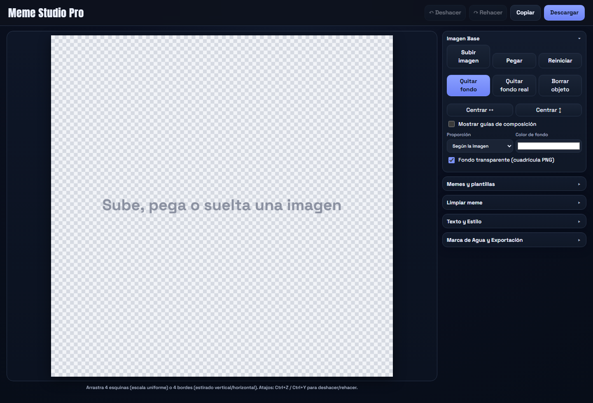
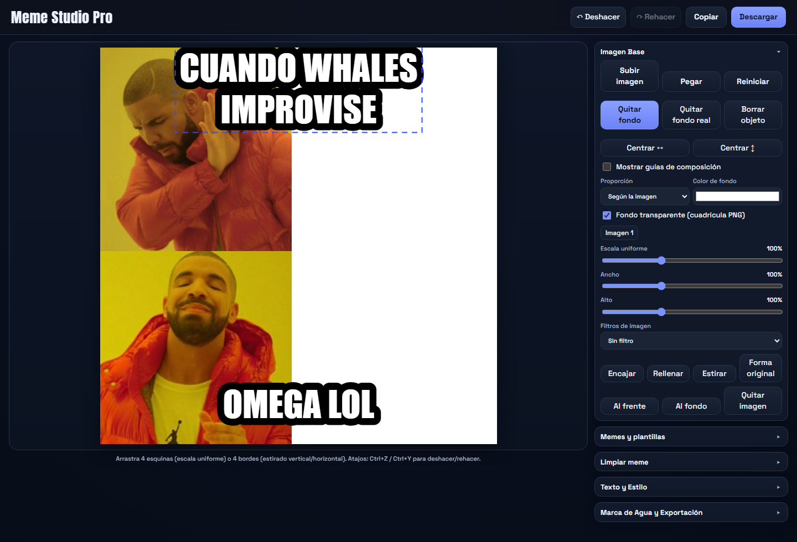
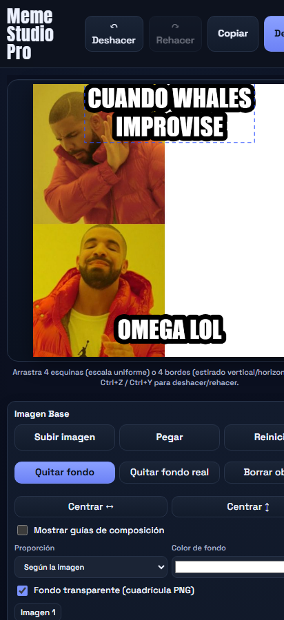

# Meme Studio Pro 🎭

> Generador y editor profesional de memes en el navegador con soporte para capas múltiples, eliminación inteligente de fondo mediante IA (Rembg / U2-Net), restaurador/inpainting de imágenes, tipografías clásicas y modernas, marcas de agua personalizadas y exportación de alta fidelidad.

| Editor (escritorio) | Con un meme cargado |
|:---:|:---:|
|  |  |
| Vista móvil (misma app, responsiva) | |
|  | |

---

## 📋 Índice

- [Características Principales](#-características-principales)
- [Arquitectura del Proyecto](#-arquitectura-del-proyecto)
- [Estructura de Archivos](#-estructura-de-archivos)
- [Requisitos Previos](#-requisitos-previos)
- [Instalación y Configuración](#-instalación-y-configuración)
- [Cómo Ejecutar el Proyecto](#-cómo-ejecutar-el-proyecto)
  - [1. Backend de Inteligencia Artificial (Python FastAPI)](#1-backend-de-inteligencia-artificial-python-fastapi)
  - [2. Frontend Web (Navegador)](#2-frontend-web-navegador)
  - [3. Script CLI Independiente](#3-script-cli-independiente)
- [Instalar como App (PWA)](#-instalar-como-app-pwa)
- [Sincronizar el borrador entre móvil y PC](#-sincronizar-el-borrador-entre-móvil-y-pc)
- [Acceso con usuario y contraseña](#-acceso-con-usuario-y-contraseña)
- [Login con cuentas (registro público)](#-login-con-cuentas-registro-público-recomendado-para-despliegues-públicos)
- [Guía de Uso y Atajos](#-guía-de-uso-y-atajos)
- [API del Backend](#-api-del-backend)
- [Documentación y Contexto para Agentes de IA](#-documentación-y-contexto-para-agentes-de-ia)
- [Diagnóstico y Correcciones Recomendadas](#-diagnóstico-y-correcciones-recomendadas)

---

## ✨ Características Principales

### 🖼️ Composición y Edición de Imágenes
- **Capas Múltiples:** Sube, pega desde el portapapeles o arrastra cualquier cantidad de imágenes (`PNG`, `JPG`, `WebP`, etc.).
- **Transformación Libre:** 8 manejadores interactivos (4 esquinas para escala uniforme y 4 bordes para deformación/estiramiento horizontal y vertical).
- **Modo Recorte:** ✂ Recorta cualquier imagen subida o pegada para reutilizarla: marco interactivo con guías de tercios y oscurecido de lo descartado; "Aplicar" hornea el recorte manteniendo lo visible exactamente en su sitio (también recorta la máscara del borrador).
- **Ajustes Rápidos:** Botones de encajar (*Fit*), rellenar (*Cover*), estirar (*Stretch*) y volver a la proporción original (*Original Shape*).
- **Filtros Gráficos:** Efectos integrados en tiempo real (Escala de grises, Alto contraste, Sepia vintage y *Deep Fry* meme frito).
- **Composición:** Opciones para cambiar relación de aspecto (1:1, 4:5, 4:3, 16:9, 9:16) y color de fondo.

### 🪄 Eliminación de Fondo (Doble Modo)
1. **Modo Local Rápido (Canvas):** Detección heurística de color de fondo y tolerancia perimetral en el cliente sin necesidad de servidor.
2. **Modo IA Real (Rembg / ONNX):** Integración con el microservicio Python local para recorte preciso de personas, mascotas y objetos complejos utilizando redes neuronales.

### 🧹 Limpiador de Memes e Inpainting
- **Pincel Restaurador:** Permite pintar sobre textos antiguos o marcas no deseadas; el algoritmo de dilatación e *inpainting* reconstruye la textura de fondo.
- **Detección inteligente de texto:** Filtro opcional para actuar únicamente sobre píxeles de texto blanco/negro dentro del área trazada.
- **Recorte Automático de Barras:** Elimina automáticamente barras superiores o inferiores de memes preexistentes.

### 🔤 Tipografía y Capas de Texto
- **Estilos Predefinidos:** Presets instantáneos (*Clásico*, *Moderno*, *Neón*, *Barra Superior*).
- **Tipografías Populares:** `Impact`, `Anton`, `Oswald`, `Montserrat`, `Comic Neue` y `Arial`.
- **Personalización Completa:** Color de relleno, trazo/borde con grosor regulable, sombra con desenfoque, opacidad y alineación (izquierda, centro, derecha).
- **Gestión por Capas:** Crear capas de texto independientes, duplicar, reordenar, bloquear y activar/desactivar mayúsculas automáticas.

### 🏷️ Marca de Agua y Exportación
- **Presets de Marca de Agua:** Esquina inferior, Centro de seguridad o Sutil.
- **Marca de Agua de Imagen (logo):** además del texto, elige tu logo (PNG con transparencia) con ancho relativo al lienzo; opacidad, posición, desenfoque y sombra compartidas con el texto. Persiste en autosave y en borradores remotos.
- **Configuración Milimétrica:** Posición X/Y en porcentaje, tamaño, opacidad, desenfoque y colores.
- **Exportación Multiformato:** Descarga directa en `PNG` (máxima fidelidad), `JPG` (tamaño ligero) o `WebP` (optimizado para web).
- **Resoluciones Predefinidas:** Original, 1080×1080 (Instagram Post), 1200×1200, 1080×1920 (TikTok/Reels/Stories) y 1920×1080 (YouTube/Twitter).
- **Copiar al Portapapeles:** Copia directa en memoria como PNG para pegar inmediatamente en Discord, Telegram, WhatsApp Web o redes sociales.

### 🌐 Catálogo y Plantillas Virales
- Plantillas locales integradas listas para usar.
- Buscador conectado en vivo con el catálogo viral de la API de Imgflip.

---

## 🏛️ Arquitectura del Proyecto

```
                     ┌───────────────────────────────────┐
                     │          Navegador Web            │
                     │  (memegnerator.html / app.mjs)    │
                     │  - Motor Canvas 2D                │
                     │  - Estado y Undo/Redo             │
                     │  - Inpainting local               │
                     └─────────────────┬─────────────────┘
                                       │
            ┌──────────────────────────┴──────────────────────────┐
            │ HTTP (fetch)                                        │ HTTP (fetch)
            ▼                                                     ▼
┌───────────────────────────────┐                     ┌───────────────────────────────┐
│     Backend FastAPI           │                     │        API Imgflip            │
│       (server.py)             │                     │   (api.imgflip.com)           │
│  - Endpoint: /api/remove-bg   │                     │  - Catálogo de memes          │
│  - rembg / ONNX Runtime       │                     │    virales en vivo            │
└───────────────────────────────┘                     └───────────────────────────────┘
```

---

## 📁 Estructura de Archivos

```plaintext
memes/
├── public/                    # Único contenido servido por HTTP (copia literal a assets/ en Android)
│   ├── memegnerator.html      # Estructura HTML de la interfaz y controles
│   ├── app.mjs                # Orquestador del frontend (Canvas, eventos, historial)
│   ├── styles.css             # Estilos con tema oscuro y diseño responsivo
│   ├── web/                   # Módulos ES puros (estado, presets, geometría, inpainting, plantillas)
│   ├── index.html             # Redirección a memegnerator.html
│   ├── manifest.json / sw.js  # PWA (instalable + offline básico)
│   └── icons/ + favicon.png   # Iconos 192/512/maskable + favicon
├── server.py                  # Entrypoint: carga Settings y lanza uvicorn
├── memestudio/                # Backend hexagonal: config, domain/, ports/, adapters/, app/ (routers FastAPI)
├── tests/                     # Suite de tests: pytest (backend) y node --test tests/js (frontend puro)
├── requirements.txt            # Dependencias de Python (FastAPI, Rembg con backend CPU, Pillow, Uvicorn)
├── opencode.json              # Configuración de OpenCode: registra el servidor MCP del grafo de Graphify
├── .gitattributes              # Merge driver de Graphify para fusionar graph.json sin conflictos
├── tools/
│   ├── remove_bg.py            # Script CLI para procesar imágenes locales desde terminal
│   ├── remove_bg.bat           # Wrapper por lotes para ejecución rápida en Windows
│   └── refresh_graph_docs.py   # Hook helper: sincroniza estadísticas del grafo en AGENTS.md
│   └── install_graphify_hooks.sh # Instalación completa de Graphify en clones nuevos (hooks + stats)
├── graphify-out/               # Grafo de conocimiento (Graphify): graph.json + GRAPH_REPORT.md
├── android/                    # App Android (APK): WebView Kotlin que reutiliza el frontend web
│   ├── app/                    # Proyecto Gradle (build.gradle, manifest, MainActivity.kt, assets/)
│   └── README_ANDROID.md       # Instrucciones de compilación del APK y límites del móvil
├── Dockerfile                  # Imagen multi-arch (x86/ARM) del stack completo
├── docker-compose.yml          # Orquestación con volumen de modelos y healthcheck
├── .gitignore                  # Archivos y carpetas excluidos del control de versiones
├── AGENTS.md                   # Contexto técnico y directrices para agentes de IA
└── README.md                   # Esta documentación
```

---

## 📦 Requisitos Previos

1. **Python 3.10 o superior** (para ejecutar el servidor de IA y el script CLI).
2. **Navegador web moderno** (Google Chrome, Microsoft Edge, Mozilla Firefox o Safari) con soporte para ES Modules y Canvas 2D.
3. *Opcional:* Node.js (si deseas utilizar servidores estáticos como `serve` o `live-server`).

---

## 🚀 Instalación y Configuración

### 1. Clonar o acceder al repositorio
Abre tu terminal en la carpeta del proyecto:
```powershell
cd <ruta/al/proyecto>  # p. ej. ~/proyectos/memes en Linux, C:\Proyectos\memes en Windows
```

### 2. Crear y activar el entorno virtual de Python
```powershell
# En Windows (PowerShell)
python -m venv .venv
.\.venv\Scripts\Activate.ps1
```

### 3. Instalar dependencias
> [!IMPORTANT]
> Es crucial instalar `rembg[cpu]` (o `rembg[gpu]` si cuentas con soporte CUDA) para que se incluya el motor de inferencia ONNX.
```powershell
pip install -r requirements.txt
```

---

## 🖥️ Cómo Ejecutar el Proyecto

### 1. Docker (modo recomendado)

**Toda la aplicación se ejecuta desde un contenedor Docker.** No necesita entorno virtual ni dependencias locales: solo Docker (o Docker Engine + el plugin de compose en Raspberry Pi).

```bash
# Configuración (opcional): copia la plantilla y edita a gusto
cp .env.example .env

# Arrancar (construye la imagen la primera vez)
docker compose up -d --build
```

**Toda la configuración va en `.env`**: modelo rembg, puerto publicado, CORS, subreddits de memes, TTL de cachés… (ver [`/.env.example`](.env.example)). `docker compose` lee el `.env` de la raíz e inyecta los valores al contenedor; sin `.env` usa los valores por defecto.

# Ver logs
docker compose logs -f memestudio

# Parar
docker compose down
```

Abre en tu navegador:
```
http://localhost:5005
```
- API Endpoint: `http://localhost:5005/api/remove-bg`
- Documentación interactiva Swagger: `http://localhost:5005/docs`
- Comprobación de estado: `http://localhost:5005/health`

> [!TIP]
> El archivo `docker-compose.yml` monta el volumen `models` sobre `~/.u2net` y `~/.rembg` del contenedor: los pesos de rembg se descargan **una sola vez** (en la primera petición) y sobreviven a reinicios y actualizaciones de la imagen.

Para forzar un modelo concreto:

```bash
REMBG_MODEL=u2netp docker compose up -d      # Linux/macOS
# o definir REMBG_MODEL antes de: docker compose up -d (PowerShell)
$env:REMBG_MODEL="u2netp"; docker compose up -d --build
```

> [!NOTE]
> En Raspberry Pi no hay que hacer nada especial: la imagen base `python:3.11-slim` es multi-arquitectura y Docker construye la versión ARM de forma nativa. Dentro del contenedor, `platform.machine()` sigue reportando `aarch64`, así que la selección automática de modelo (`u2netp`) funciona igual que fuera del contenedor.

---

### 2. Servidor Local sin Docker (desarrollo)

> [!NOTE]
> `python server.py` también lee el mismo `.env` de la raíz (PORT, HOST, REMBG_MODEL, REDDIT_SUBS, MEME_CACHE_TTL, IMG_CACHE_MAX, CORS_ORIGINS). Con `.env` present, cambia puerto/host/modelo sin tocar código.

> **Modo todo-en-uno:** [`server.py`](server.py) sirve tanto la API de eliminación de fondos con IA como la aplicación web del frontend de forma integrada en un solo comando:

```powershell
# Con el entorno virtual activado:
python server.py
```
Abre en tu navegador:
```
http://localhost:5005
```
- API Endpoint: `http://localhost:5005/api/remove-bg`
- Documentación interactiva Swagger: `http://localhost:5005/docs`
- Comprobación de estado: `http://localhost:5005/health`

---

### 3. Frontend Independiente (Obsoleto)

> [!NOTE]
> Ya **no es necesario** iniciar un servidor estático separado (`python -m http.server 8000` o `npx serve`). El frontend y la API ahora viven en la misma app FastAPI: con `python server.py` todo se sirve en `http://localhost:5005`, y la llamada a la API usa una ruta relativa (`/api/remove-bg`) que funciona sin importar el puerto.

> [!WARNING]
> Evita abrir `memegnerator.html` haciendo doble clic directo (`file:///`):
> La aplicación utiliza módulos JavaScript nativos (`<script type="module" src="./app.mjs">`). Los navegadores bloquean la importación de módulos vía `file://` debido a directivas de seguridad CORS. **Debe servirse mediante `python server.py` (un solo comando, un solo puerto).**

---

### 4. Script CLI Independiente

Si deseas eliminar el fondo de una imagen directamente desde la línea de comandos sin abrir el navegador:

```powershell
# Usando el script en Python
python tools/remove_bg.py "ruta/a/entrada.jpg" "ruta/a/salida.png"

# O mediante el ejecutable por lotes en Windows
.\tools\remove_bg.bat "entrada.png" "salida.png"
```

### 5. Ejecución en Raspberry Pi (o ARM)

**Modo principal en la Pi: Docker.** Instala Docker Engine en la Pi (Raspberry Pi OS 64-bit) y arranca con `docker compose up -d --build` desde la raíz del repo — la construcción es nativa ARM, sin emulación.

El backend detecta la arquitectura de la máquina al arrancar:

- **ARM (Raspberry Pi, Jetson...):** usa automáticamente el modelo ligero `u2netp` (~4.7 MB, 4–6× más rápido en CPU ARM).
- **x86/x64 (PC):** usa `u2net` completo con máxima calidad.
- Se puede forzar cualquier modelo con una variable de entorno: `REMBG_MODEL=u2net` (o `u2netp`, `isnet-general-use`, ...).

> [!TIP]
> En una Pi, configura **4 GB de RAM o más** y deja el proyecto en una SD rápida. La primera petición descarga el modelo a `~/.u2net`; a partir de ahí todo es local.

> [!NOTE]
> Los archivos de tooling de agentes (`.kindex/`, `opencode.json`) no son necesarios para ejecutar la app; en un clon para ARM puede eliminarse `.kindex/` (contiene un binario Windows) y regenerar los hooks de Graphify con `graphify hook install`.

---

### 6. App Android (APK)

El repo incluye un proyecto Android nativo (`android/`, WebView Kotlin) que empaqueta el editor tal cual y guarda los exportes en la **galería del móvil**. Compílalo con Android Studio (`File > Open` sobre `android/` → `Build APK(s)`); instrucciones completas, límites del móvil y el modo de conectar el backend rembg vía "Servidor IA" están en [`android/README_ANDROID.md`](android/README_ANDROID.md).

---

## 📲 Instalar como App (PWA)

La app es una **PWA instalable**: desde Chrome o Edge (escritorio o móvil, `http://localhost:5005` en el PC o `http://IP-del-PC:5005` en la LAN) usa el icono/botón **«Instalar app»** y quedarás con tu propio icono, ventana propia y la interfaz **en caché offline**.

- **Service worker** (`sw.js`): cachea la interfaz (estáticos y fuentes); las llamadas a `/api/*` siempre van a la red (la IA necesita el servidor).
- Los assets cacheados se invalidan solos al subir el `?v=N` del HTML.
- En la app Android APK esto no aplica: la WebView ya instala la interfaz como assets (`file://`), sin service worker.
- **Deep-link para compartir un borrador:** `http://localhost:5005/?img=<url-de-imagen>&t1=<texto superior>&t2=<texto inferior>` abre el editor con la imagen y los dos textos precargados.

---

## 🔄 Sincronizar el borrador entre móvil y PC

Los borradores guardados por el autosave viven en el `localStorage` de **cada dispositivo** (el navegador del PC y la app del móvil no comparten nada por sí solos). Para continuar un meme en otro sitio hay botones de sincronización (usables siempre que haya backend: en la web con el servidor, o en Android con "Servidor IA" configurado):

- **☁ Subir borrador** — guarda en el servidor el meme **completo** (imagen, capas, posiciones, filtros, marca de agua…) como el borrador de tu usuario.
- **↧ Traer borrador** — reemplaza el canvas por lo guardado en el servidor (con confirmación).

Flujo típico: editas en el móvil → "Subir borrador" → te sientas al PC → "Traer borrador" (y viceversa).

El borrador vive en `drafts/<usuario>.json` en el servidor (uno por usuario) y viaja como JSON, así que sigue editable: no es un PNG exportado. Dentro de tu red funciona solo; para hacerlo accesible desde fuera de casa, ver la sección siguiente.

---

## 🔐 Acceso con usuario y contraseña

Si expones el servidor fuera de tu red (por ejemplo con **Cloudflare Tunnel** apuntando a `localhost:5005`), puedes pedir usuario y contraseña a cualquiera que entre: en el `.env` define

```
AUTH_USERS=daniel:mipass,novia:supass
```

- Vacio (por defecto) = sin login, como siempre (ideal para LAN).
- Con valor, **toda la app pide login** con el diálogo nativo del navegador (Basic Auth). El `/health` queda abierto para el healthcheck de Docker.
- **Cada usuario tiene su PROPIO borrador remoto**: tú y quien compartas el acceso sincronizan sus memes por separado sin pisarse.
- Comparación de contraseñas a prueba de timing (`secrets.compare_digest`).
- Nota para la APK Android: su WebView no soporta el diálogo de login del Basic Auth → si activas contraseñas, en el móvil usa la **PWA** del servidor (se instala desde `https://tu-tunnel/…` con el botón "Instalar" de Chrome) en lugar de la APK, o deja `AUTH_USERS` vacío.
- Tras cambiar `AUTH_USERS`, reinicia `python server.py` (o `docker compose up -d`).

---

## 👤 Login con cuentas (registro público; recomendado para despliegues públicos)

Si vas a abrir el servidor a gente de fuera (proyecto público), puedes usar **cuentas reales con registro** en lugar de Basic Auth: en el `.env` define

```
REQUIRE_LOGIN=1
```

- **Registro desde la propia interfaz**: al entrar aparece el panel "Iniciar sesión / Crear cuenta"; el usuario se registra él mismo (nombre + contraseña de 8+ caracteres) y su sesión queda guardada en una cookie `HttpOnly` de 30 días (`SESSION_DAYS`).
- **Contraseñas nunca en claro**: se almacenan con hash **scrypt** (N=16384, sal aleatoria por usuario) en SQLite (`data/memestudio.db`, configurable con `AUTH_DB`). No hay forma de recuperar contraseñas: los usuarios borran, no se resetean.
- **La API queda cerrada; el frontend abierto**: sin sesión ninguna llamada a `/api/*` responde 401; los estáticos (HTML/JS/CSS) siguen servidos para poder renderizar el formulario de login.
- **Protecciones incluidas**: rate-limit en memoria (5 registros/5 min por IP, 10 logins/5 min por IP), rechazo de orígenes cruzados en los POST con cookie (mitigación CSRF, junto a `SameSite=Lax`), usuario único case-insensitive y nombre validado (3-24 caracteres).
- **Opcional**: `REGISTRATION_OPEN=0` cierra el registro (solo entran cuentas ya creadas) y `PUBLIC_HTTPS=1` si el servidor vive detrás de HTTPS (Cloudflare Tunnel, proxy inverso) para marcar la cookie como `Secure`.
- Los borradores de `/api/draft` se guardan por cuenta igual que con Basic Auth (`drafts/<usuario>.json`).
- Prioridad de modos: `AUTH_USERS` (Basic) > `REQUIRE_LOGIN=1` (cuentas) > abierto (LAN, por defecto).

---

## ⌨️ Guía de Uso y Atajos

| Atajo de Teclado | Acción |
| :--- | :--- |
| `Ctrl + Z` | Deshacer el último cambio |
| `Ctrl + Y` o `Ctrl + Shift + Z` | Rehacer el cambio deshecho |
| `Ctrl + Enter` | Descargar el meme inmediatamente en el formato seleccionado |
| `Delete` o `Backspace` | Eliminar la imagen o capa de texto actualmente seleccionada |
| `Ctrl + V` | Pegar imagen directamente desde el portapapeles del sistema |
| *Arrastrar y soltar* | Arrastra cualquier archivo de imagen sobre el lienzo para añadirlo |

### Manipulación sobre el lienzo:
- **Arrastre central:** Mueve la imagen o el texto sobre el lienzo.
- **4 Esquinas:** Escala uniforme proporcional.
- **4 Bordes laterales/verticales:** Estiramiento individual de ancho o alto.
- **Modo Limpiar (Borrador):** Pinta con el pincel sobre marcas de agua o texto no deseado y presiona **«Borrar lo pintado»**.
- **Modo Recorte (✂):** "Recortar" en el panel de imágenes: ajusta el marco naranja (handles y guías de tercios, como el escalado) y confirma con **«Aplicar recorte»**; el marco se re-arma para volver a recortar la misma capa.

### Autoguardado:
- Cada acción (arrastrar, pintar, cambiar textos/estilos…) escribe el borrador en `localStorage` ~1.2s después de parar de interactuar, además de al minimizar o cerrar la pestaña. Al reabrir, el borrador se restaura solo.

---

## 🔌 API del Backend

### `GET /health`
Verifica la disponibilidad del servicio.
- **Respuesta:** `{"status": "ok"}`

### `POST /api/remove-bg`
Recibe una imagen y devuelve la imagen procesada en formato PNG con fondo transparente y **auto-recortada al sujeto** (se elimina el área 100% transparente sobrante).
- **Content-Type:** `multipart/form-data`
- **Body:** `image: <archivo binario>`
- **Respuesta:** Stream de imagen binaria `image/png` (dimensiones = sujeto + margen anti-aliasing).
- **Cabecera `X-Crop-Box:`** `left,top,ancho_original,alto_original` — región del original que sobrevive al recorte, para reposicionar la capa en clientes integrados (el frontend de la app la usa para mantener el sujeto en su sitio exacto).

### `GET /api/meme-search`
Búsqueda de plantillas virales con **matching difuso** sobre el top-100 de Imgflip: normaliza acentos ("camion" encuentra variantes con tilde), tolera tipeos cercanos (`difflib`) y pondera por palabras. Sin término devuelve una muestra aleatoria del catálogo. El catálogo se cachea 5 minutos en el servidor para no castigar la API de Imgflip.
- **Query:** `q=<texto>` (opcional), `limit=<n>` (max 24, por defecto 24)
- **Respuesta:** `{"data":{"memes":[{"name","url","width","height"}]}}` — cada `url` es una **ruta de este mismo servidor** (proxy), ver siguiente endpoint.

### `GET /api/meme-image`
Proxy de la imagen del meme servida desde este servidor en lugar de `i.imgflip.com`, para que el canvas del navegador nunca quedara contaminado (*tainted*) y la exportación a PNG/WebP siempre funcione.
- **Query:** `src=<url de imgflip>` (solo dominios `*.imgflip.com` — rechaza lo demás con 400)
- **Respuesta:** bytes de la imagen con su `Content-Type` correcto (JPEG/PNG/GIF/WEBP); cache simple en memoria.

### `GET /api/meme-search-reddit`
Búsqueda de memes en Reddit vía el archivo público de Arctic Shift (sin clave de API; la red JSON de reddit.com suele estar bloqueada). Con término: busca por título en varios subreddits de memes (r/dankmemes, r/me_ira, …); sin término: muestra aleatoria de memes populares. Filtra NSFW, tiene caché 5 min y pacing anti-429.
- **Query:** `q=<texto>` (opcional), `limit=<n>` (max 24)
- **Respuesta:** mismo shape que `/api/meme-search`; las `url` van por `/api/meme-image` (dominios permitidos: imgflip, redd.it, imgur).

### `POST /api/draft` / `GET /api/draft`
Sincronización de borradores entre dispositivos (móvil ↔ PC). Cada usuario guarda **su** borrador completo (JSON con imagen en dataURL, capas, posiciones, filtros y ajustes) en `drafts/<usuario>.json`; el usuario lo identifica la sesión de su cuenta (`REQUIRE_LOGIN=1`), la Basic Auth (`AUTH_USERS`), o es `local` si el servidor corre sin contraseña.
- **`POST`:** body = borrador JSON (máx `DRAFT_MAX_MB` MB) → `{"ok":true,"user","bytes","saved_at"}`
- **`GET`:** el borrador guardado; `X-Saved-At` con la fecha de la última subida. `404` si el usuario aún no subió nada.
- Requiere backend (en Android, configurar "Servidor IA").

---

## 🤖 Documentación y Contexto para Agentes de IA

Este repositorio mantiene un **grafo de conocimiento estructural** del código con [Graphify](https://graphify.com), pensado para que agentes de IA (OpenCode, Claude Code, Cursor, Codex, etc.) consulten la arquitectura del proyecto en lugar de adivinarla grepeando archivos. El detalle completo de operaciones está en [`AGENTS.md`](AGENTS.md); aquí va el resumen para agentes que se conecten.

### ¿Qué provisiona el repo?

| Pieza | Descripción |
| :--- | :--- |
| `graphify-out/graph.json` | Grafo de símbolos reales del proyecto (Python y ES modules) con aristas explicadas (`EXTRACTED` / `INFERRED`), comunidades y god nodes. |
| `graphify-out/GRAPH_REPORT.md` | Reporte generativo de la arquitectura (se regenera en cada commit). |
| `opencode.json` | Registra un servidor MCP local `graphify` con 10 herramientas de consulta del grafo. |
| Servidor MCP `graphify` | Acepta múltiples agentes a la vez: todos leen el mismo grafo; lo recarga automáticamente cuando se regenera. |

### Conectar un agente al grafo (resumen)

1. Instalar el servidor MCP en la máquina: `uv tool install "graphifyy[mcp]"`.
2. Registrarlo apuntando al grafo (desde la raíz del repo, ruta relativa `graphify-out/graph.json`):
   - **OpenCode:** `opencode mcp add graphify -- graphify-mcp graphify-out/graph.json`.
   - **Claude Code:** `claude mcp add --transport stdio graphify -- graphify-mcp graphify-out/graph.json`.
   - **Codex:** `codex mcp add graphify -- graphify-mcp graphify-out/graph.json`.
   - **Cursor / genéricos:** usar el bloque `mcpServers` de `AGENTS.md`.
3. Verificar llamando a la herramienta `graph_stats` del servidor; debe devolver el recuento de nodos/aristas/versionado que figura en `AGENTS.md`.

Las instrucciones definitivas (y los comandos exactos por plataforma) están en la sección **«Graphify — Grafo de Conocimiento del Código»** de [`AGENTS.md`](AGENTS.md). Los agentes deben leer ese archivo antes de tocar el código.

### Automatización por hooks de Git

Los hooks instalados en el repositorio mantienen la documentación técnica viva sin intervención manual:

```powershell
graphify hook install   # re-instala los bloques de Graphify en .git/hooks (recomendado tras clonar)
```

- **Tras cada `commit`, `checkout` de rama, `merge` o `rewrite`:**
  1. Graphify reconstruye `graph.json`, `GRAPH_REPORT.md` y el visor HTML de forma incremental (solo archivos cambiados, sin llamadas a LLM).
  2. `tools/refresh_graph_docs.py` sincroniza el bloque de estadísticas `<!-- graphify-stats -->` de `AGENTS.md` con el grafo vigente.
- **Regla para agentes:** ante preguntas de estructura, llamadores o impacto de un cambio, consultar primero el grafo (vía MCP `query_graph`, `get_node`, `shortest_path`) o el CLI (`graphify query/explain/path/affected`), y reservar `grep` para cadenas exactas.

---

## 🔍 Diagnóstico y Correcciones Recomendadas

Durante la auditoría del proyecto se identificaron los siguientes puntos importantes:

1. **Dependencia de ONNX en `requirements.txt` (Resuelto en entorno local):**
   - *Problema:* El paquete base `rembg>=2.0.57` no incluye por defecto el motor de inferencia ONNX Runtime. Al importar `rembg`, el servidor arrojaba `No onnxruntime backend found`.
   - *Solución:* Se instaló `onnxruntime` y se recomienda especificar `rembg[cpu]>=2.0.57` en `requirements.txt`.

2. **Acceso vía `file://` vs `http://` (Resuelto):**
   - *Problema:* Doble clic en `memegnerator.html` provoca un error de CORS en el navegador que impide cargar `app.mjs`.
   - *Solución:* El servicio de archivos estáticos está integrado en `server.py` mediante `FastAPI.mount()`; `python server.py` sirve frontend y API como una sola app.

3. **Nombre del archivo HTML:**
   - *Observación:* `memegnerator.html` contiene una errata tipográfica ("memegnerator" en vez de "memegenerator"). Existe un `index.html` que redirige a la app, así que `http://localhost:5005/` carga el frontend por defecto.

4. **Sincronización de UI en "Borrar objeto":**
   - *Observación:* Al hacer clic en el botón `eraseObjectBtn`, el estado interno `state.cleanOn` se activa, pero la casilla de verificación `#cleanOn` del acordeón "Limpiar meme" no se actualiza ni se despliega el acordeón para mostrar los controles del pincel.

5. **Excepción no controlada en Preset "Barra":**
   - *Observación:* En `app.mjs`, si el usuario elimina todas las capas de texto y pulsa el botón del preset "Barra", el código intenta acceder a `state.layers[0]`, generando un `TypeError: Cannot convert undefined or null to object`. Se debe asegurar que exista al menos una capa antes de asignarle propiedades.

6. **Bloqueo horizontal al alinear texto:**
   - *Observación:* En `draw()`, si el texto está alineado a la izquierda (`left`) o derecha (`right`), la coordenada horizontal de anclaje se fija a un porcentaje estático (12% u 88%), ignorando el valor `l.x` que produce el arrastre con el ratón.

7. **Procesamiento síncrono en FastAPI (`server.py`):**
   - *Observación:* La función `remove_bg` está declarada como `async def`, pero ejecuta `remove(rgba)` que es una llamada síncrona de CPU intensiva. Esto bloquea el hilo principal del Event Loop de FastAPI. Cambiar la firma a `def remove_bg(...)` síncrona permite que FastAPI la ejecute automáticamente en un hilo del *threadpool*.
